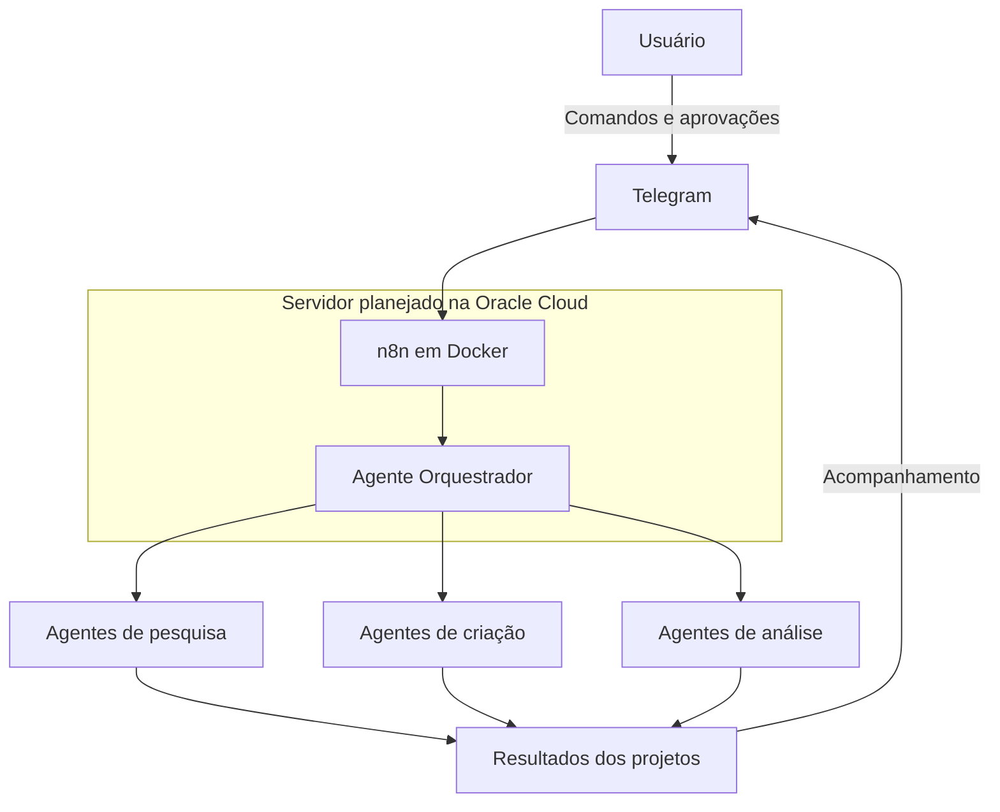

# Arquitetura planejada

Data: 30/10/2026. Esta arquitetura é conceitual e ainda não foi validada em execução.

## Visão geral

O diagrama representa o fluxo discutido, sem definir protocolos, bibliotecas ou contratos de integração.

## Primeiro piloto escolhido

Em 30/10/2026, o usuário escolheu receber e organizar tarefas pelo Telegram. O fluxo proposto é Telegram → validação no n8n → armazenamento persistente das tarefas → resposta no Telegram. O piloto cobre cadastro, listagem e conclusão por regras simples; a escolha do armazenamento e a implementação continuam pendentes. Ver [Primeiro teste](PRIMEIRO_TESTE.md).

A verificação da Oracle foi adiada por problemas de conexão relatados pelo usuário. O diagrama geral continua representando a visão futura do projeto.

## Componentes discutidos

| Componente | Papel previsto | Situação |
| --- | --- | --- |
| Telegram | Receber comandos e apresentar resultados e pedidos de aprovação | Planejado; bot e integração não confirmados |
| Oracle Cloud | Hospedar a infraestrutura, priorizando recursos gratuitos elegíveis | Conta criada segundo relato; instância não confirmada |
| Docker | Executar os serviços em contêineres | Planejado no servidor |
| n8n | Coordenar automações e etapas de execução | Planejado; instalação e workflows não confirmados |
| Agente Orquestrador | Planejar, distribuir e acompanhar tarefas | Conceitual |
| Agentes especializados | Executar pesquisa, criação e análise | Conceituais |
| Este repositório | Preservar documentação, decisões e progresso | Registro oficial |

## Definições ainda necessárias

- Sistema operacional, tipo de instância, capacidade disponível e elegibilidade gratuita.
- Versões dos serviços e compatibilidade com a arquitetura de processador escolhida.
- Persistência de dados do n8n e eventual banco de dados.
- Forma de integração com o Telegram e modelo de permissões.
- Provedor de modelos, custos de uso e limites por tarefa.
- Critérios para aprovação humana, tratamento de erros e interrupção de tarefas.
- Acesso administrativo, HTTPS, regras de rede, armazenamento de credenciais e backups.
- Implementação e validação do piloto de tarefas pelo Telegram, cujo escopo está descrito em PRIMEIRO_TESTE.md.

Esses itens são pendências de projeto, não configurações já adotadas. Não há arquivos de implantação ou comandos de provisionamento neste registro inicial.

## Custos e operação

A direção discutida é começar com recursos gratuitos. Não foram reproduzidas cotas numéricas do histórico, pois disponibilidade, condições e limites precisam ser conferidos no painel e na documentação vigente antes de provisionar recursos.

O planejamento também menciona backups externos e controles de acesso. A implementação dessas medidas não foi confirmada.
